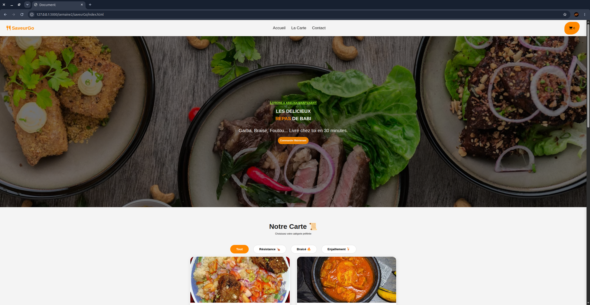
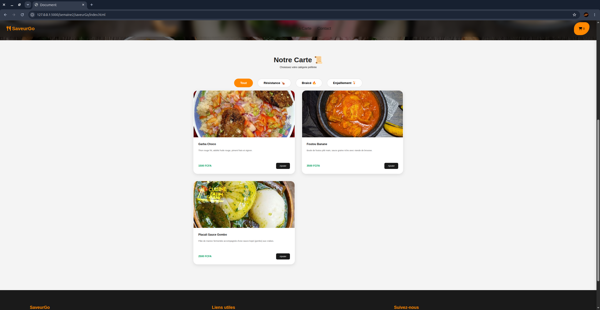
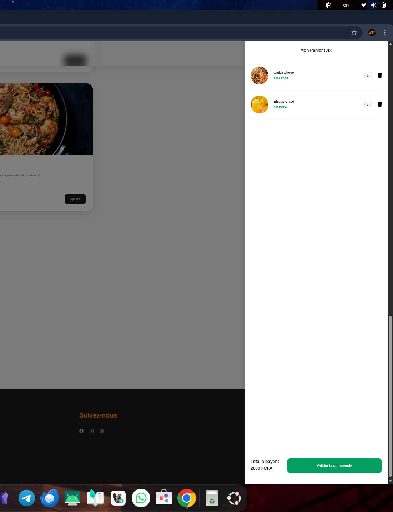

# SAVEURGO - Application de Commande de Plats

> **Challenge 8 Projets - Semaine 2**
> Une application web dynamique pour commander les meilleurs plats d'Abidjan, entièrement codée en **TypeScript Vanilla**.

## Objectif Pédagogique

Ce projet a été conçu spécifiquement pour mettre en pratique :
- **TypeScript** : Utilisation du typage strict, création d'interfaces (`Mplat`, `PanierItem`), structuration du code et compilation via `tsc`.
- **Manipulation du DOM** : Création et mise à jour dynamique d'éléments HTML, gestion des événements (clics, filtres, modifications de quantité), et animation de la barre latérale du panier sans framework externe.

## Aperçu

| Page d'accueil | Liste des produits | Panier d'achat |
|:---:|:---:|:---:|
|  |  |  |

## Fonctionnalités

- **Menu Interactif** : Génération et affichage dynamique des plats dans le DOM à partir d'une structure de données typée.
- **Filtrage Dynamique** : Filtrage des plats par catégorie (Résistance, Braisé, Enjaillement) via les attributs `dataset`.
- **Gestion du Panier en Temps Réel** :
  - Ajout de produits et gestion des doublons.
  - Calcul et mise à jour automatique du montant total.
  - Incrémentation et décrémentation des quantités.
  - Suppression dynamique d'articles du panier.
- **Interface Utilisateur** : Sidebar animée pour le panier avec overlay interactif.

## Stack Technique

- **Langage** : TypeScript (Typage strict, Interfaces, Manipulations DOM).
- **Intégration** : HTML5, CSS3 (Flexbox, CSS Grid, Variables CSS).
- **Compilation** : Compilateur TypeScript (`tsc`) sans bundler.
- **Architecture** : Modules ES6 (`import` / `export`).

## Architecture du Projet

```text
SAVEURGO/
├── assets/             # Captures d'écran et ressources visuelles
│   ├── acceuil.png
│   ├── panier.png
│   └── products.png
├── src/                # Code Source TypeScript
│   ├── db.ts           # Données de simulation (plats)
│   ├── types.ts        # Interfaces et typages TypeScript
│   ├── main.ts         # Logique applicative et événements DOM
│   └── style.css       # Fichier de styles
├── dist/               # Fichiers JavaScript compilés par tsc
├── index.html          # Point d'entrée principal
├── package.json        # Dépendances et scripts
└── tsconfig.json       # Configuration du compilateur TypeScript
